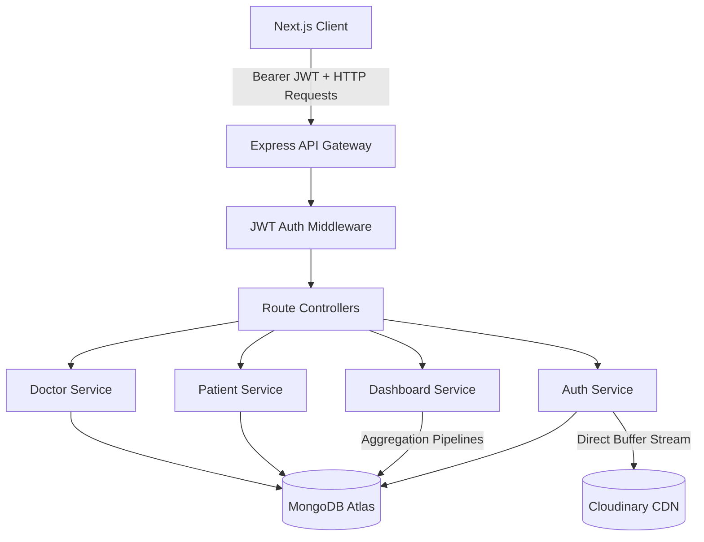

# Doctor Tracker — Backend REST API

## Description
Doctor Tracker is a secure, high-performance administrative healthcare API designed to streamline doctor management, patient records, and clinical analytics. Engineered with Node.js, Express, TypeScript, and MongoDB Atlas, the system provides JWT-authenticated administrative endpoints, aggregated capacity reporting, robust search and multi-criteria filtering, and automatic Cloudinary avatar asset lifecycle management.

---

## Setup Guide

### Prerequisites
- Node.js (v18 or higher)
- pnpm (or npm / yarn)
- MongoDB Atlas cluster or local MongoDB instance
- Cloudinary account (for avatar uploads)

### Step-by-Step Installation

1. **Clone the repository and enter directory:**
   ```bash
   git clone <backend-repo-url>
   cd doctorTraker-Backend
   ```

2. **Install dependencies:**
   ```bash
   pnpm install
   ```

3. **Configure Environment Variables:**
   Copy `.env.example` to `.env` and fill in your credentials:
   ```bash
   cp .env.example .env
   ```

   **`.env.example` Reference:**
   ```env
   PORT=5000
   NODE_ENV=development
   CLIENT_URL=http://localhost:3000
   MONGODB_URI=mongodb+srv://<username>:<password>@cluster0.xxxxx.mongodb.net/doctorTracker?retryWrites=true&w=majority

   JWT_SECRET=your_jwt_secret_key_dt2026
   JWT_EXPIRES_IN=7d

   CLOUDINARY_CLOUD_NAME=your_cloudinary_cloud_name
   CLOUDINARY_API_KEY=your_cloudinary_api_key
   CLOUDINARY_API_SECRET=your_cloudinary_api_secret
   ```

4. **Build and Run:**
   - **Development mode:**
     ```bash
     pnpm run dev
     ```
   - **Production build & start:**
     ```bash
     pnpm run build
     pnpm start
     ```

5. **Initial Admin Credentials:**
   - **Email:** `admin@doctortracker.com`
   - **Password:** `Admin@DT2026`

---

## System Architecture



### Key API Modules
- **Authentication (`/api/auth`)**: Register, login, profile inspection, and avatar upload with automatic cleanup of replaced assets.
- **Doctor Management (`/api/doctors`)**: CRUD operations, multi-field search, date and hospital filtering, pagination with `$facet`, nested patient assignment, and patient detachment.
- **Patient Management (`/api/patients`)**: List all patients with search, condition filtering, doctor attribution, date-wise filtering, and record updates.
- **Dashboard Analytics (`/api/dashboard`)**: Aggregated metrics including total counts, patient-to-doctor ratios, doctor patient distributions, condition breakdowns, and 30-day admission trends.

---

## Technical Decisions

### 1. MongoDB Aggregation Pipelines with `$facet` for Single-Roundtrip Pagination
Instead of issuing separate `find()` and `countDocuments()` queries across the database connection for every page request, the API utilizes MongoDB's `$facet` aggregation stage. This allows computing the total matched records and retrieving the sliced document page in a single query execution. Furthermore, `$lookup` joins allow real-time counting of assigned patients per doctor without storing denormalized mutable count caches that could drift out of sync.

### 2. Stream-Based Cloudinary Image Ingestion with Automatic Garbage Collection
Rather than saving uploaded files to ephemeral server disks before passing them to external storage, Multer's memory storage buffer streams images directly into Cloudinary using Node.js stream passthroughs. When an administrator uploads a new profile photo, the service records Cloudinary's `public_id` and systematically destroys previous image assets, preventing orphaned file storage accumulation and reducing cloud storage costs.

---

## Evaluation Credentials
- **Admin Email:** `admin@doctortracker.com`
- **Admin Password:** `Admin@DT2026`
